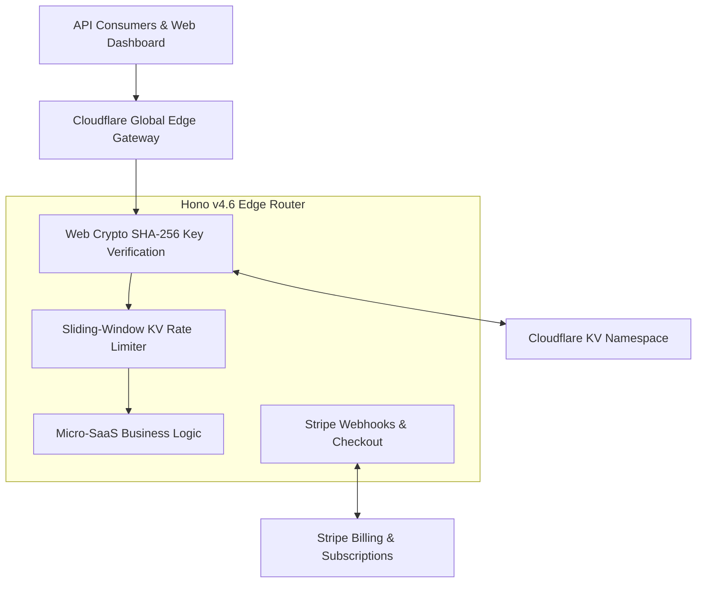

<div align="center">
  
</div>

# NexusPulse EdgeSaaS Starter Kit

> **Launch a high-margin, zero-cold-start Micro-SaaS on Cloudflare Workers in under 15 minutes.**  
> Pre-configured with Hono, TypeScript, Stripe Subscriptions, Web Crypto API Key Auth, and KV Rate Limiting.

[](https://workers.cloudflare.com)
[](https://hono.dev)
[](https://stripe.com)
[](https://www.typescriptlang.org)
[](#license)

---

## Why EdgeSaaS?

Most developer starter kits force you onto bloated container clusters or heavy serverful frameworks with $20-$50/month idle hosting bills before you make your first dollar.

**NexusPulse EdgeSaaS** runs entirely on the **Cloudflare Global Edge Network**:
- **$0.00 Base Cost**: Runs on Cloudflare's generous free tier (100,000 requests/day free).
- **Sub-15ms Global Latency**: Code runs across 300+ data centers worldwide right next to your users.
- **Zero Cold Starts**: Powered by V8 isolates, eliminating Node/Docker boot delays.
- **Production-Ready Stripe Billing**: Out-of-the-box checkout sessions, webhook handlers, customer portal, and tier management.

---

## Architectural Blueprint



---

## Included Features

| Feature | Implementation | Business Value |
|---|---|---|
| **Edge Router** | Hono v4.6 + TypeScript | Ultra-fast routing with full type safety |
| **API Key Authentication** | Web Crypto SHA-256 | Fast, zero-database crypto validation |
| **Edge Rate Limiting** | Cloudflare KV sliding-window | Prevents abuse & enforces plan quotas |
| **Stripe Billing** | Stripe SDK Fetch Adapter | Seamless Checkout, Portal, and Webhooks |
| **Tier Rate Cards** | `/api/tiers` endpoint | Transparent self-serve upgrade path |
| **Automated Testing** | Vitest suite | Guaranteed zero regressions upon deploy |
| **1-Click Deployment** | Wrangler CLI configuration | Deploy to global production in seconds |

---

## Quickstart Guide

### 1. Clone & Install Dependencies
```bash
git clone https://github.com/NexusPulse/nexus-edgesaas-boilerplate.git my-saas
cd my-saas
npm install
```

### 2. Configure Environment Secrets
Copy `.env.example` to `.dev.vars` for local development:
```bash
STRIPE_SECRET_KEY=sk_test_...
STRIPE_WEBHOOK_SECRET=whsec_...
STRIPE_PRICE_STARTER=price_...
STRIPE_PRICE_PRO=price_...
```

### 3. Run Locally
```bash
npm run dev
```
Test the health endpoint:
```bash
curl http://localhost:8787/health
```

### 4. Run Automated Test Suite
```bash
npm test
```

### 5. Deploy to Production
```bash
npx wrangler kv namespace create SAAS_KV
# Update wrangler.jsonc with your KV id, then:
npm run deploy
```

---

## Built-In API Endpoints

- `GET /health`: Global edge operational health check.
- `GET /api/tiers`: Pricing plans and quota configurations.
- `POST /api/keys/generate`: Instant free-tier developer API key provisioning.
- `POST /api/billing/checkout`: Creates Stripe Checkout Session for Starter or Pro plans.
- `POST /api/billing/webhook`: Verifies Stripe signatures and provisions quota upon payment.
- `POST /v1/analyze`: Example protected edge micro-service with rate limiting and API key auth.

---

## Commercial Licensing & Instant Checkout

Choose the right license for your project. Micro-priced for developers to launch without friction:

| License Tier | Price | Coverage | Instant Checkout |
| :--- | :--- | :--- | :--- |
| **Community Edition** | **Free** | MIT License, personal / open-source use | [Clone on GitHub](https://github.com/MilindChatrabhuji/edgesaas-starter-kit) |
| **Pro Developer License** | **$9 USD (~Rs 750 INR)** | 1 Commercial Production SaaS, Multi-tenant Admin, Stripe/PayPal webhooks | [**Buy Pro License ($9)**](https://paypal.me/milindchatrabhuji/9usd) |
| **Agency Unlimited License** | **$19 USD (~Rs 1,600 INR)** | Unlimited Client Deployments, Full White-label Rights, Direct Priority Support | [**Buy Agency License ($19)**](https://paypal.me/milindchatrabhuji/19usd) |

> **Instant Settlement Guarantee:** All payments are processed directly via PayPal (`milind.chatrabhuji@gmail.com`) with instant license delivery and a 14-day money-back guarantee.
> For enterprise inquiries: `milind.chatrabhuji@gmail.com`.
